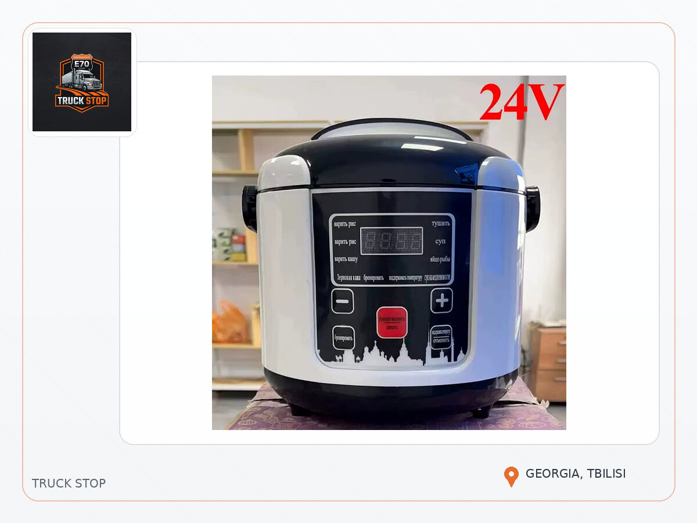

# Изображения и Lazy Loading

## Оптимизированные изображения
Все фото уже оптимизированы:
- JPG quality 82 + progressive
- WebP версии
- Максимум 1200px по длинной стороне
- Метаданные удалены

Папка: `images/brand/` и `images/products/`

## Как работает lazy loading на сайте

1. **Native lazy loading** — на всех товарах стоит `loading="lazy"`
2. **decoding="async"** — не блокирует рендер
3. **fetchpriority="high"** — только у hero-баннера
4. **picture + WebP** — браузер сам выбирает лучший формат
5. Плавное появление через CSS (класс `.lazy` → `.loaded`)

### Пример правильной разметки товара:

```html
<picture>
  <source srcset="images/products/19_multivarka.webp" type="image/webp" />
  
</picture>
```

## Что нужно сделать
1. Создай папку `images` в корне репозитория
2. Залей туда содержимое из артефактов проекта (`truckstop-images/brand` и `truckstop-images/products`)
3. Или скачай оптимизированные файлы и положи в `images/brand/` и `images/products/`

После этого сайт будет полностью работать с ленивой загрузкой.
